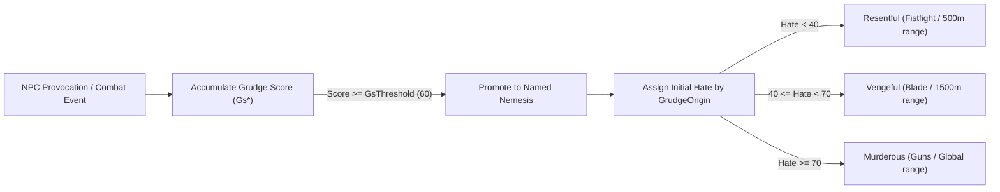
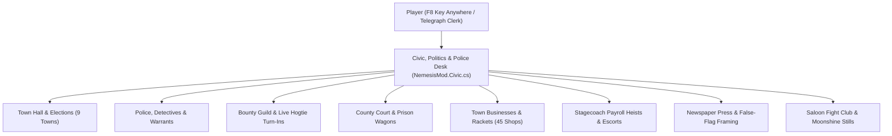

# EnRAGE (v0.9.5.3-civic) — Architecture, Build Pipeline & Mechanics Reference

## 1. Compilable C# Project & Build Pipeline

### 1.1 Resolving `ScriptHookRDRNetAPI` (`v2.2.0.0`)
Because the binary distribution only ships `scripts/NemesisMod.dll` and `scripts/Newtonsoft.Json.dll` (expecting `ScriptHookRDRNetAPI.dll` in the RDR2 game root), initial decompilation without `ScriptHookRDRNetAPI.dll` could not distinguish value types/enums (`RDR2.eWeapon`, `RDR2.PedHash`, `RDR2.BoneID`, `RDR2.Math.Vector3`) from reference types.

To solve this with 100% metadata fidelity:
1. Every `TypeRef` (`55` types across `RDR2`, `RDR2.Native`, `RDR2.Math`, `RDR2.UI`) and every `MemberRef` (`405` distinct `RDR2.*` methods, constructors, properties, fields, events, and indexers) were extracted from `scripts/NemesisMod.dll`.
2. [`decompiled/refs/ScriptHookRDRNetAPI.Stub.cs`](../decompiled/refs/ScriptHookRDRNetAPI.Stub.cs) was generated and compiled into [`decompiled/refs/ScriptHookRDRNetAPI.dll`](../decompiled/refs/ScriptHookRDRNetAPI.dll) (`Version=2.2.0.0`).
3. `NemesisMod.dll`'s internal startup API validator [`ApiCheck.Missing(Assembly mod, out int checkedApi)`](../decompiled/NemesisMod/NemesisSystem/ApiCheck.cs) was executed against the stub assembly:
   - **Checked `RDR2.*` API members**: `405`
   - **Missing `RDR2.*` API members**: `0`
4. `ilspycmd` decompiled the entire assembly into [`decompiled/NemesisMod/`](../decompiled/NemesisMod) with full project structure, preserving all nullable enums (`eWeapon?`, `PedHash?`, `BoneID?`) and value-type constraints.

### 1.2 Rebuilding `NemesisMod.dll` & Running Verification
You can modify any `.cs` file or embedded [`doors.json`](../decompiled/NemesisMod/doors.json) under `decompiled/NemesisMod/` and rebuild immediately:
- **Build from root**: Run [`build.cmd`](../build.cmd) (compiles `decompiled/NemesisMod/bin/Release/net48/NemesisMod.dll` and updates `scripts/NemesisMod.dll`).
- **Automated 6-point verification**: Run `powershell -ExecutionPolicy Bypass -File verify.ps1` to compile the project, verify `0` missing `RDR2.*` API members, check all 13 factions, parse `.ini` files, validate all 12 `.json` templates, and deserialize `politics.json`.

---

## 2. Extracted Configuration (`.ini`) & JSON Modding Templates (`config_templates/`)

All 14 default configuration and modding template files are located in [`config_templates/`](../config_templates):

| File | Runtime Destination (relative to `scripts/`) | Exporter / Source Class | Purpose |
| :--- | :--- | :--- | :--- |
| [`NemesisMod.ini`](../config_templates/NemesisMod.ini) | `scripts/NemesisMod.ini` | [`NemesisSettings.Save()`](../decompiled/NemesisMod/NemesisSystem/NemesisSettings.cs) | Master INI configuration (Version 50): keybinds (`CivicMenu=F8`), ambush rates, cheat-death chances, tension, gang wars, companions, UI layout |
| [`BulletImpact.ini`](../config_templates/BulletImpact.ini) | `scripts/BulletImpact.ini` | [`BulletImpactSettings.Save()`](../decompiled/NemesisMod/NemesisSystem/BulletImpact/BulletImpactSettings.cs) | Ballistics & X-Ray configuration (Version 5): crippling toggle, player weapon damage multiplier (`0.6`), kill-shots, X-Ray rect budget (`1500`) |
| [`politics.json`](../config_templates/politics.json) | `scripts/NemesisData/politics.json` | [`CivicState`](../decompiled/NemesisMod/NemesisSystem/CivicSystem.cs) | Default Civic, Politics, Law Enforcement, Court, Business & Bounty state across all 9 frontier towns |
| [`factions.json`](../config_templates/factions.json) | `scripts/enRAGE/content/factions.json` | [`Gangs.BuiltInExport`](../decompiled/NemesisMod/NemesisSystem/Gangs.cs) / [`FactionContent.Export`](../decompiled/NemesisMod/NemesisSystem/FactionContent.cs) | All 13 built-in factions (`odriscoll`, `lemoyneraiders`, `army`, `klan`, `wapiti`, `bronte`, `murfree`, `skinners`, `laramie`, `delobo`, `nightfolk`, `pinkertons`, `marshals`) + support for custom factions |
| [`places.json`](../config_templates/places.json) | `scripts/enRAGE/content/places.json` | [`NemesisMod.ExportPlaces()`](../decompiled/NemesisMod/NemesisSystem/NemesisMod.cs) | 15 RDR2 districts (zone hashes, 1899 & 1907 faction hold weights) + 12 towns (Doctor & Saloon coordinates, `CoreRadius`) |
| [`lives.json`](../config_templates/lives.json) | `scripts/enRAGE/content/lives.json` | [`Backstory.Export()`](../decompiled/NemesisMod/NemesisSystem/Backstory.cs) | Procedural NPC backstory pools, Civil War Grey/Blue battles, and regional hometowns |
| [`world_life.json`](../config_templates/world_life.json) | `scripts/enRAGE/content/world_life.json` | [`WorldLife.Export()`](../decompiled/NemesisMod/NemesisSystem/WorldLife.cs) | Autonomous everyday life events for roster NPCs (marriage, children, brawls, pets, scars, friendships) |
| [`tales.json`](../config_templates/tales.json) | `scripts/enRAGE/content/tales.json` | [`NemesisMod.ExportTales()`](../decompiled/NemesisMod/NemesisSystem/NemesisMod.cs) | Historical world lore entries and faction-specific RAID / CLASH / DUTY tales |
| [`questions.json`](../config_templates/questions.json) | `scripts/enRAGE/content/questions.json` | [`Questions.Export()`](../decompiled/NemesisMod/NemesisSystem/Questions.cs) | Interrogation questions (`What`, `When`, `Where`, `Why`), required conditions, fear thresholds, and lie flags |
| [`wildcards.json`](../config_templates/wildcards.json) | `scripts/enRAGE/content/wildcards.json` | [`NemesisMod.ExportWildcards()`](../decompiled/NemesisMod/NemesisSystem/NemesisMod.cs) | WorldSim `TURMOIL` wildcard event weights, `BadBlood` lines, and `Deals` lines |
| [`doors.json`](../config_templates/doors.json) | `scripts/enRAGE/content/doors.json` | [`NemesisMod.BuiltInDoors()`](../decompiled/NemesisMod/NemesisSystem/NemesisMod.cs) | 2,000+ RDR2 door hashes, models, and world coordinates used to unlock hideout buildings |
| [`camps.json`](../config_templates/camps.json) | `scripts/enRAGE/content/camps.json` | [`CampsContent`](../decompiled/NemesisMod/NemesisSystem/CampsContent.cs) | User-customizable extra camp sites file |
| [`camps_builtin_reference.json`](../config_templates/camps_builtin_reference.json) | *(Reference only)* | [`Camps`](../decompiled/NemesisMod/NemesisSystem/Camps.cs) | Reference dump of all 97 built-in O'Driscoll and gang camp sites & hideout coordinates |
| [`cards/builtin.json`](../config_templates/cards/builtin.json) | `scripts/enRAGE/content/cards/builtin.json` | [`NemesisMod.BuiltInCards()`](../decompiled/NemesisMod/NemesisSystem/NemesisMod.cs) | All built-in Encounter Cards (`idle`, `callout`, `riders`, `ahead`, `sniper`, `skirmish`, `patrol`, `hunters`) |

---

## 3. Core Gameplay Mechanics

### 3.1 Grudge Score (`Gs*`), Promotion Thresholds & Hate Tiers
Every NPC you interact with accumulates a floating-point **Grudge Score** before being promoted to a named Nemesis on your roster ([`Balance.cs`](../decompiled/NemesisMod/NemesisSystem/Balance.cs), [`Hate.cs`](../decompiled/NemesisMod/NemesisSystem/Hate.cs)):

- **Promotion threshold**: `GsThreshold = 60` (`GsFloor = 25`, settle window `GsSettleSeconds = 20`).
- **De-escalation**: `GsGreet = -6`, `GsDefuse = -12`.
- **Escalation**: `GsDrawOn = +6`, `GsPunch = +8`, `GsIntimidate = +10`, `GsShotAt = +10`, `GsComradeKilled = +14`, `GsInsult = +15`, `GsFoughtBack = +15`, `GsShotAgain = +15`, `GsStickUp = +20`, `GsHogtie = +35`, `GsKnockOut = +40`, `GsHorseStolen = +40`, `GsRobbed = +45`, `GsWounded = +50`, `GsSlashed = +55`.
- **Cheat Death Formula**:
  $$\text{CheatDeathChance} = \min\bigl(\text{CheatDeathMaxChance}\ (60\%),\ \text{CheatDeathBaseChance}\ (35\%) + \text{Rank} \times \text{CheatDeathPerRank}\ (5\%)\bigr)$$
  If `FatalWoundsFinal = true` (default), an X-Ray fatal blow (brain destroyed or heart pierced) or dismemberment/decapitation permanently blocks Cheat Death.

### 3.2 `BulletImpact` 3D X-Ray Ballistics, Crippling & Arterial Bleedout
The [`NemesisSystem.BulletImpact`](../decompiled/NemesisMod/NemesisSystem/BulletImpact/BulletImpactModule.cs) subsystem runs its own 3D anatomical raycaster on every projectile/melee impact:
- **Instant Kill Shots (`KillShots = true`)**: Destroying the `brain` or piercing the `heart` kills the target immediately regardless of remaining health.
- **Human Arterial & Organ Bleedout (`CheckHumanBleed` / `UpdateHumanBleeds`)**:
  - Severing the **carotid artery** triggers a `6.0s` staggering bleedout.
  - Severing the **femoral artery** triggers a `9.0s` staggering bleedout.
  - Piercing the **trachea/windpipe** or collapsing **both lungs** (`lung_l` + `lung_r`) triggers a `10.0s` suffocation/bleedout.
- **Permanent & Tactical Crippling ([`CrippleRules.Assess`](../decompiled/NemesisMod/NemesisSystem/BulletImpact/CrippleRules.cs))**:
  - `cervical` broken -> `CrippleLevel.NeckBroken` (*"Neck broken - paralyzed"*).
  - `spine_t` or `spine_l` severed -> `CrippleLevel.SpineBroken` (*"Spine severed - paralyzed"*).
  - `pelvis`, `knee_l/r`, `femur_l/r`, both `foot_l & foot_r`, or both `tibia_l & tibia_r` shattered -> `CrippleLevel.Legless` (*"can't stand"*, target crawls on the ground).
  - Single `foot_l/r` or single `tibia_l/r` shattered -> `CrippleLevel.Limping` (*"limping"*).

---

## 4. Civic, Politics, Law Enforcement & Frontier Expansion (`v0.9.5.3-civic`)

### 4.1 9 Interactive Frontier Subsystems
1. **Tiered Law Enforcement, Detectives & Bribery** ([`NemesisMod.Civic.cs`](../decompiled/NemesisMod/NemesisSystem/NemesisMod.Civic.cs)):
   - Each town tracks **Case Heat (`0–100%`)**, an active **Lead Detective**, and a **Warrant Tier** (`Clear`, `Misdemeanor`, `Felony`, `DeadOrAlive`).
   - Players can **Bribe the Town Sheriff** for **24 in-game hours of local law immunity**, **Expunge Case Files** via corrupt clerks, **Buy Police Wiretap Intel** to expose a random gang's Treasury, or **Dispatch a Marshal Posse** against a rival gang.
2. **Town Politics, Mayors, Elections & Regimes**:
   - All 9 frontier towns (`Valentine`, `Rhodes`, `Saint Denis`, `Strawberry`, `Blackwater`, `Annesburg`, `Van Horn`, `Armadillo`, `Tumbleweed`) have a sitting **Mayor**, **Challenger**, **Approval (`0–100%`)**, **Corruption (`0–100%`)**, **Tax Rate**, and **7-day Election cycle**.
   - **4 Regimes**: `Reformist`, `CorruptMachine` (cheap sheriff bribes + `10%` daily tax kickback to allied players), `FrontierPopulist`, and `MartialLaw`.
   - **Mayoral Rally Encounter**: Summon the sitting Mayor and 3 Pinkerton bodyguards in the 3D world; eliminating the Mayor triggers an emergency succession where the Challenger immediately takes office.
3. **Martial Law, Night Curfews & Road Checkpoints**:
   - Under `MartialLaw` or `Felony`/`DeadOrAlive` warrants, towns enforce a **`22:00–05:00` Night Curfew**: wearing a mask or carrying a drawn firearm in town triggers immediate Sheriff/Marshal warnings and adds Case Heat.
   - Armed **Pinkerton & Marshal Road Checkpoints** (`wagon02x` barricade + 4 riflemen) can spawn ahead on the road and demand a toll or open fire on wanted outlaws.
4. **County Court, Prison Wagon Convoys & Jailbreaks**:
   - Captured gang officers, companions, and NPCs arrested in front of you (`ArrestedByLaw`) appear on the **County Court Docket** with a scheduled **Public Hanging** day.
   - Players can **Pay Court Bail** to release the prisoner legally (who rewards the player with gang Treasury intel) or **Ambush the Prison Wagon Convoy** (`wagonPrison01x` escorted by 4 U.S. Marshals) in the 3D world.
5. **Town Business Protection Rackets & Frontier Bank**:
   - **45 Businesses** (5 per town: `Saloon`, `Gunsmith`, `GeneralStore`, `Doctor`, `Hotel`) can be bought as **Legal Partnerships** (`100%` daily income, upgradable to Level 5), **Extorted as Protection Rackets** (`135%` daily income), or **Liberated from Rival Gang Enforcers** in a 3D turf shootout.
   - **Frontier Bank & Trust** pays **`+5%` daily compound interest** on deposits and offers commercial loans (`8%` daily interest).
6. **Bounty Hunting Guild, Wanted Contracts & Live Hogtie Jail Turn-Ins**:
   - Accept **Dead-or-Alive Wanted Contracts** (`BountyContract`) on high-ranking outlaw captains: hogtie the target alive for the full **`100%–150%` Alive Payout + Town Reputation + automatic County Court Docket booking**, or shoot them for the `50%` Dead payout.
   - Carrying *any* hogtied gang member or Nemesis within `22m` of a Town Sheriff / Civic Desk unlocks **`TURN IN HOGTIED CAPTIVE ALIVE`** (`+\$160`, `-20` Case Heat, `+Town Rep`, and books them into `Civic.Prisoners`).
7. **Stagecoach Payroll Heists & Armed Escort Contracts**:
   - **Rob Armored Payroll Stagecoach**: Pay a `\$30` clerk tip to spawn a federal payroll stagecoach (`coach2`) guarded by 4 Pinkerton/Marshal riflemen; wipe out the escort to loot **`\$250`** from the strongbox.
   - **Accept Mayor's Payroll Escort Contract**: Defend the town's stagecoach against 5 ambushing gang road agents to earn **`\$135` + `+10` Mayor Approval + `-20` Case Heat**.
8. **Newspaper Press Control, Propaganda & Framing Rivals**:
   - **Heroic Puff Piece (`\$45`)**: Prints a front-page story boosting `Chronicle.TownWord` goodwill and dropping Case Heat by `25`.
   - **Mayoral Smear Campaign (`\$75`)**: Prints leaked corruption ledgers, dropping the Mayor's approval by `-22%` and boosting the Challenger by `+18%`.
   - **Frame Rival Gangs (`\$110`)**: Prints a false-flag massacre story blaming one outlaw gang on another (`ShiftRelation(g1, g2, -65, ..., force: true)`), immediately igniting a **Gang War**.
9. **Saloon Prize-Fight Clubs & Moonshine/Smuggling Backrooms**:
   - **Bare-Knuckle Championship Bout (`\$50` Stake -> Win `\$150`)**: Spawns a `320 HP` unarmed saloon bruiser for a 1-on-1 fistfight.
   - **Backroom Moonshine Still (`\$140`)**: Upgrades the town's Saloon (`HasMoonshineStill = true`), permanently adding **`+\$25/day`** illicit revenue.
